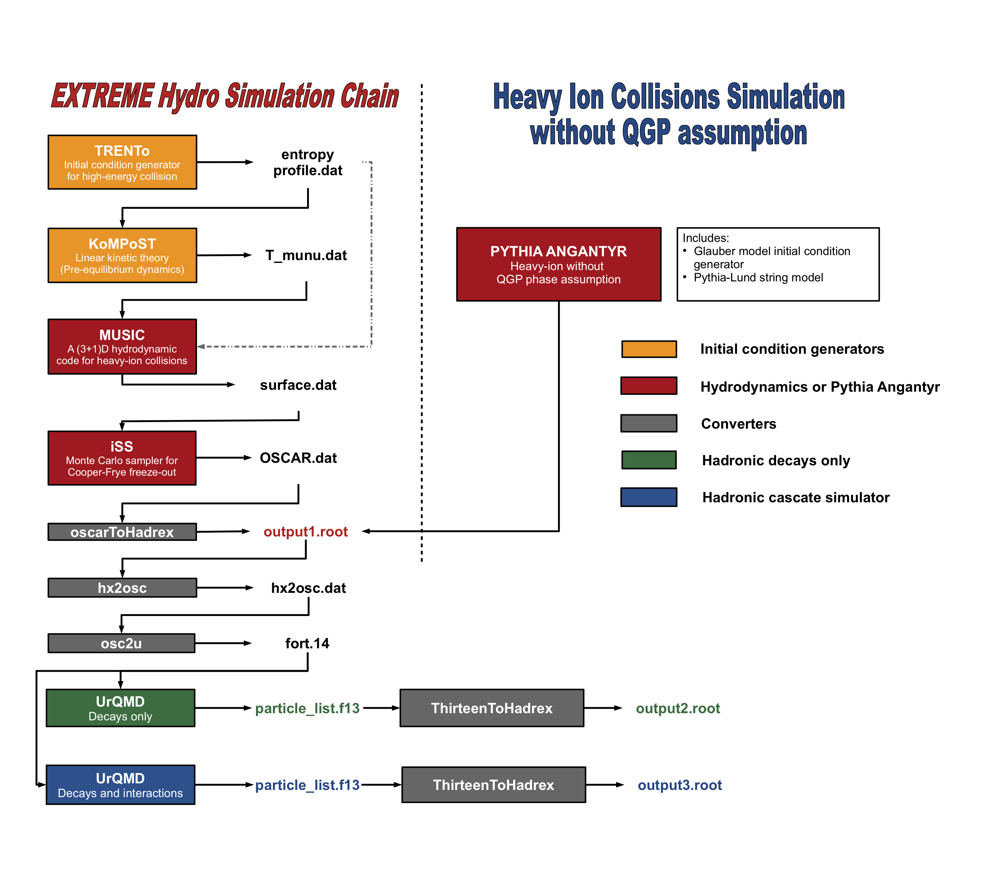

The ExTrEMe collaboration develops and maintains a multi-stage simulation pipeline to model relativistic heavy-ion collisions from the earliest collision geometry through hydrodynamic expansion to final-state particle spectra and correlations.

  
  
The ExTrEMe multi-stage simulation chain and alternative baseline workflows.

## Pipeline Overview

The framework models the collision through distinct physical stages, connecting microscopic dynamics with macroscopic collective expansion:

### 1. Initial State & Geometry
- **TRENTo**: A phenomenological initial condition generator implementing an effective generalized-mean ansatz for energy and entropy deposition in heavy-ion collisions.
- **PYTHIA / Angantyr**: For baseline calculations without the assumption of a Quark-Gluon Plasma (QGP) core, collisions can be modeled using the Angantyr model based on the Pythia Lund string fragmentation framework.

### 2. Pre-equilibrium Dynamics
- **KoMPoST**: Bridges the early collision geometry with viscous hydrodynamics by evolving energy-momentum tensor perturbations $T^{\mu\nu}$ using kinetic theory, providing consistent hydrodynamic initial conditions at initialization time $\tau_{\text{hydro}}$.

### 3. Relativistic Viscous Hydrodynamics
- **MUSIC**: A state-of-the-art (3+1)D relativistic viscous hydrodynamic simulation that solves energy-momentum conservation and relaxation equations for shear stress $\pi^{\mu\nu}$ and bulk viscous pressure $\Pi$. It evolves the expanding quark-gluon plasma until local temperatures drop below the pseudo-critical transition temperature, extracting a freeze-out hypersurface.

### 4. Particlization
- **iSS**: A Monte Carlo particle generator implementing the Cooper-Frye formalism across the freeze-out surface, converting continuous fluid fields into individual hadrons with viscous corrections to momentum distributions.

### 5. Hadronic Cascade & Decays
- **UrQMD**: Simulates microscopic hadronic transport, elastic and inelastic rescattering, and resonance decays in the dilute hadronic phase. The pipeline supports:
  - **Decays only**: For isolating freeze-out signatures from subsequent hadronic evolution.
  - **Decays and interactions**: Full transport simulation modeling hadronic medium modifications.

### 6. Analysis & Model-to-Data Comparison
- **Hadrex Converters (`oscarToHadrex`, `ThirteenToHadrex`)**: Format converter utilities producing ROOT analysis trees for extracting observables including anisotropic flow coefficients ($v_n$), momentum-dependent flow fluctuations, scaled transverse-momentum spectra, and Bayesian model-to-data parameter estimation.
